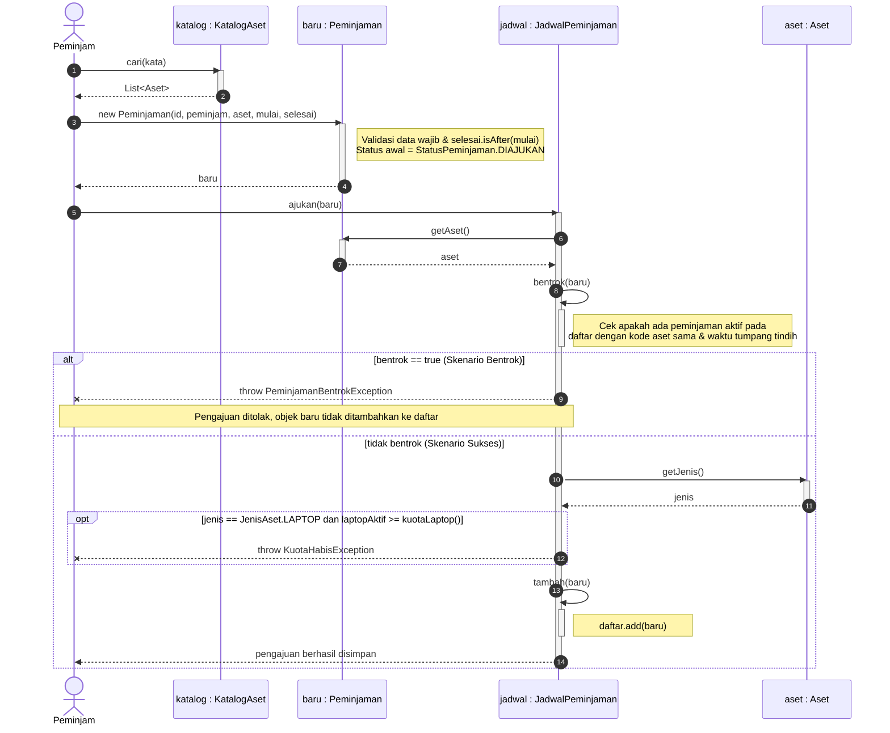

# Sequence Diagram — Pengajuan Peminjaman Aset

Diagram ini memodelkan alur pengajuan peminjaman aset pada sistem **Aset-Pinjam** menggunakan fragmen `alt` untuk memisahkan skenario **bentrok** dan skenario **sukses**.

## Sumber Diagram

Berkas sumber Mermaid mentah: [`sequence-peminjaman.mmd`](./sequence-peminjaman.mmd).

## Penjelasan Skenario

1. **Pencarian & Inisialisasi (`1–4`)**:
   - Peminjam mencari aset yang tersedia melalui `KatalogAset.cari(kata)`.
   - Peminjam membuat objek `Peminjaman` dengan status awal `StatusPeminjaman.DIAJUKAN`. Konstruktor memvalidasi kelengkapan data serta memastikan `selesai.isAfter(mulai)`.
2. **Pemeriksaan Jadwal (`5–8`)**:
   - Peminjam memanggil `JadwalPeminjaman.ajukan(baru)`.
   - `JadwalPeminjaman` mengambil informasi aset dan memeriksa potensi konflik jadwal melalui `bentrok(baru)`.
3. **Skenario Bentrok (`alt: bentrok == true`)**:
   - Apabila waktu peminjaman tumpang tindih untuk aset dengan kode yang sama, `JadwalPeminjaman` langsung melempar `PeminjamanBentrokException` dan objek `baru` tidak ditambahkan ke `daftar`.
4. **Skenario Sukses (`else: tidak bentrok`)**:
   - Sistem mengecek jenis aset melalui `aset.getJenis()`. Khusus jenis `JenisAset.LAPTOP`, apabila kuota aktif peminjam sudah mencapai batas `kuotaLaptop()`, sistem melempar `KuotaHabisException`.
   - Jika seluruh validasi terpenuhi, `JadwalPeminjaman` memanggil `tambah(baru)` untuk memasukkan peminjaman ke dalam `daftar` dengan status `DIAJUKAN`.
